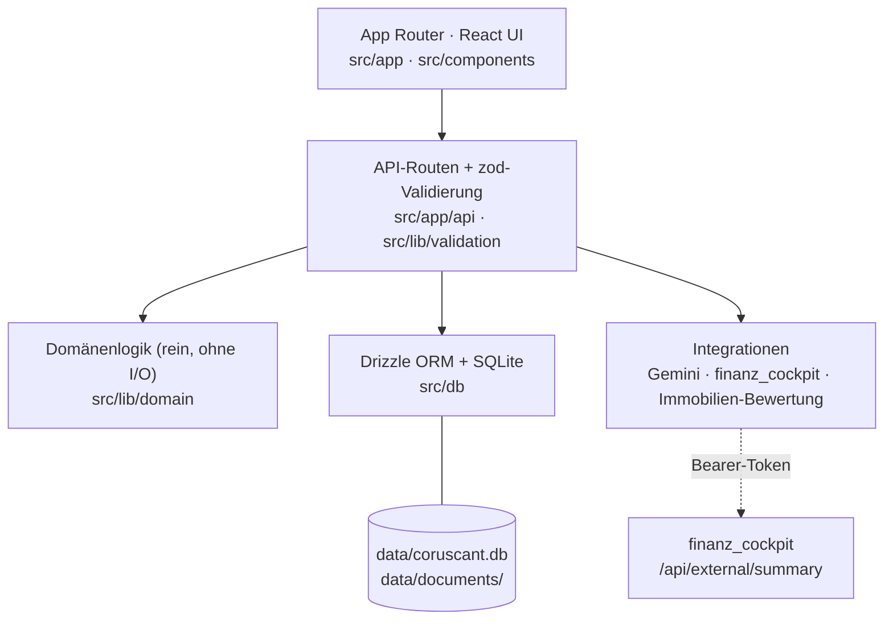

<div align="center">

# 🌌 Coruscant

### Haushalts- & Vermögens-Zentrale

**Bilanz, Verträge, Cashflow-Verteilung und Belege an einem Ort. Local-First, präzise und KI-unterstützt, aber nie eigenmächtig.**


</div>

---

## ✨ Was ist Coruscant?

Coruscant ist der **strategische Hub** des Haushalts. Die App führt Kredite, Bausparer und Immobilien in einer Bilanz zusammen und rechnet das echte Nettovermögen aus. Dazu gehört auch das Vermögen aus dem operativen [`finanz_cockpit`](../finanz_cockpit), das über eine schlanke, token-geschützte Bridge einfließt. Sie schlägt vor, wohin freies Geld fließen sollte, und sie liest Belege per KI aus. Alle Daten bleiben lokal auf deinem Rechner.

> **Zwei-Sphären-Prinzip:** `personal` (`finanz_cockpit`) und `household` (Coruscant) bleiben strikt getrennt, damit private Daten nie ungewollt in die Haushaltssicht rutschen.

## 🧩 Features

### 🏠 Haushalts-Cockpit (`/`)
Hero-KPIs für Aktiva, Passiva und echtes Nettovermögen (inklusive `finanz_cockpit`-Sync), dazu der Balken *Frei · Gebunden · Schulden* und eine Meilenstein-Zeitachse. Es gibt bewusst keine langen Tabellen und keine Formulare.

### 📜 Verträge & Immobilien (`/vertraege`)
- Generisches Register für **Kredite, Privatdarlehen und Bausparverträge**
- **Immobilien** mit Nutzung `owner_occupied` oder `rented`
- CRUD per Modal, Detail-Drawer mit **projiziertem vs. geeichtem Stand** und Belegen
- Tab *Portfolio* (`?tab=portfolio`) für vermietete Objekte, vor Steuern und als *Modelliert* gekennzeichnet
- Optionale automatische Immobilien-Wertschätzung über einen austauschbaren Valuator

### 💧 Cashflow & Wasserfall (`/allokation`)
- Haushalts-Positionen mit Einnahmen und Ausgaben (monatlich, quartalsweise, jährlich)
- **Priorisierte Ziel-Töpfe** mit Regeln `fill_to_target`, `fixed_monthly` und `percentage_of_remainder`
- Optionale Kopplung der Töpfe an Konten und Positionen aus `finanz_cockpit`
- **„Geld verteilen“**: Die Wasserfall-Engine macht einen Vorschlag, du bestätigst mit einem Klick.

### 📄 KI-Dokumenten-Inbox (`/dokumente`)
- PDF-Upload mit SHA-256-Duplikaterkennung
- KI-Extraktion, per `zod` validiert, in der Queue *„Zu prüfen“*
- **Split-Screen-Review:** PDF links, KI-Vorschlag und Eich-Checkbox rechts
- **Vertrags-Eichung** aus Kontoauszügen und Steuer-Tagging
- **Steuer-Sammler** (`/dokumente/steuer?jahr=YYYY`): Jahres-Belegmappe nach Kategorie (§ 35a, Werbungskosten, Kapitalerträge), Druckansicht sowie Export als **ZIP, CSV oder JSON**

### 🔭 Szenario-Labor (`/planung`)
Read-only-Simulationen, die nichts in der Datenbank ändern:
- *Wohin mit X €?* und *Sparrate empfehlen* auf einer deterministischen Engine
- *Sondertilgung vs. ETF*
- *Gehaltssprung*: Wann füllen sich die Ziel-Töpfe?
- **„Erklär mir das“**: KI-Investment-Coach mit Bewertung und Q&A (zustandslos, nur auf Klick)
- **Kaufrechner** (`/planung/kaufrechner`) für Immobilien, vor Steuern

### 🧾 Berater-Bericht (`/bericht`)
Ein druckbarer Bericht für Gespräche mit Beratern. Personenbezogene Daten werden vorher geprüft und anonymisiert.

## 🎨 Design: „Eichamt“

Tinte auf Kalkpapier, Barlow als Schrift, Farbe nur dort, wo sie finanzielle Bedeutung trägt (Aktiva, Passiva, gebundenes Vermögen, KI). Details in [`docs/DESIGN-SYSTEM.md`](docs/DESIGN-SYSTEM.md).

Die Oberfläche trennt Datenqualität auf einen Blick:

| Darstellung | Bedeutung |
| --- | --- |
| **Solide** Linie + Eichmarke | ✅ *Geeicht / Ist*: belegte Werte |
| **Gestrichelt** (`border-dashed`) + gestrichelter Ring | 📐 *Modelliert / Schätzung*: berechnete Werte |
| **Signalocker** + Raute | 🤖 *KI-Vorschlag*: wartet auf deine Bestätigung |

Alle Beträge nutzen Tabellenziffern; Daten erscheinen einheitlich als `TT.MM.JJJJ` bzw. `MM.JJJJ`. Light und Dark Mode laufen über `next-themes`.

## 🏗️ Architektur



- **Domänen-Isolation:** Alle Berechnungen (Wasserfall, Vertrags-Fortschreibung, Cashflow, Bilanz) liegen in `src/lib/domain/`, ohne Next-, React-, HTTP- oder DB-Imports. ESLint erzwingt das.
- **Datenbankzugriff** nur über Drizzle in `src/db/`.
- **Generik statt Hardcoding:** Es gibt keine Sonderfälle für einzelne Kredite, Personen oder Verträge im Code.
- **KI hinter einem Adapter:** Das Modell kommt nur über `GEMINI_MODEL`. Die KI ändert nie still Bestandsdaten.

## 🔢 Rechenprinzipien

- **Geldbeträge** als Integer in Cent (`amountCents`), nie als `float`
- **Zinssätze** als Basispunkte (`interestRateBps`, `350` = 3,50 %)
- Negativ- und Grenzfalltests für jede Domänenlogik: 0-Cent-Werte, Überzahlungen, Rundungsgrenzen und ungültige KI-Outputs

## 🚀 Schnellstart

Voraussetzungen: Node.js und [`pnpm`](https://pnpm.io).

```bash
pnpm install
cp .env.example .env.local   # Werte siehe unten
pnpm db:migrate              # SQLite-Schema anlegen
pnpm dev                     # http://localhost:3000
```

Damit der Sync funktioniert, muss `finanz_cockpit` auf `http://localhost:3001` laufen. In beiden Apps muss `EXTERNAL_SUMMARY_TOKEN` gleich sein.

### ⚙️ Konfiguration (`.env.local`)

| Variable | Zweck |
| --- | --- |
| `DATABASE_URL` | Pfad zur SQLite-Datei (Standard: `data/coruscant.db`) |
| `GEMINI_API_KEY` | API-Key für Dokumenten-Extraktion und Coach |
| `GEMINI_MODEL` / `GEMINI_FALLBACK_MODEL` | Modell und Fallback, nie im Code hartcodiert |
| `FINANZ_COCKPIT_URL` | Basis-URL der Bridge (Standard: `http://localhost:3001`) |
| `FINANZ_COCKPIT_PUBLIC_URL` | URL für Links ins Cockpit |
| `FINANZ_COCKPIT_SYNC_INTERVAL_MINUTES` | Sync-Intervall (Standard: `15`) |
| `EXTERNAL_SUMMARY_TOKEN` | Gemeinsames Bridge-Token, in beiden Apps identisch |
| `CORUSCANT_HOUSEHOLD_DUMMY` | Dev-Dummy-Modus für das Gemeinschaftskonto (`auto` · `true` · `false`) |
| `IMMOANALYSE_API_KEY` / `IMMOANALYSE_BASE_URL` | Optional: Immobilien-Wertschätzung |
| `ENABLE_VALUATION_SCHEDULER` / `DISABLE_SCHEDULER` | Optional: Hintergrund-Scheduler steuern |

### 🧪 Qualitäts-Checks

```bash
pnpm typecheck && pnpm lint && pnpm test
```

Eine Aufgabe gilt erst als fertig, wenn alle drei ohne Fehler durchlaufen.

## 🔗 Bridge zu `finanz_cockpit`

Coruscant liest `GET /api/external/summary` aus `finanz_cockpit` mit einem Bearer-Token. Die Antwort wird mit `zod` validiert und als Snapshot in `external_snapshots` gespeichert. Optionale Felder wie `accounts[]` und `positions[]` werden tolerant geparst, und Zeitstempel werden auf ISO normalisiert. So bleibt der Sync abwärtskompatibel.

## 🗺️ Roadmap

| Version | Horizont | Inhalt |
| --- | --- | --- |
| **v1** | Ordnung & Überblick | Bilanz, Vertragsregister, Immobilie, Cashflow-Adapter, Wasserfall-Engine, Bridge, KI-Dokumenten-Inbox, Steuer-Tagging |
| **v2** | Strategie & Investieren | Szenario-Labor, KI-Investment-Coach, Steuer-Jahressammler |
| **v3** | Immobilien-Skalierung | Vermietungs-UI, Kaufrechner, Cashflow-Adapter für ein echtes Gemeinschaftskonto |

## 🔒 Datenschutz & Sicherheit

- Datenbanken (`data/*.db*`), Belege (`data/documents/`, `*.pdf`), `.env*` und `secrets/` stehen in der `.gitignore`.
- In Code, Tests und Kommentaren stehen **nur klar fiktive Dummy-Daten** (z. B. *Musterbank*, *Musterstraße 1*).
- Das Dev-Transparenz-Panel („Was die KI sieht“) ist in Production-Builds immer aus.

## 🧑‍💻 Entwicklungs-Workflow

Git-Fluss: `feature/*` → Pull Request → `dev` → `main`. Auf `main` und `dev` wird nie direkt entwickelt.

| Schritt | Agent | Befehl |
| --- | --- | --- |
| 🗺️ Planen | Argon | `/plan-slice` |
| 🔨 Umsetzen | Hydrogen | `/execute-task` |
| 🔍 Review | Argon | `/review-slice` |
| 🩹 Fixen | Hydrogen | `/fix-review` |

Mehr dazu in [`docs/SPEC.md`](docs/SPEC.md), [`docs/ARCHITECTURE.md`](docs/ARCHITECTURE.md) und [`docs/DESIGN-SYSTEM.md`](docs/DESIGN-SYSTEM.md).

## 📄 Lizenz

Privates Projekt, alle Rechte vorbehalten.
