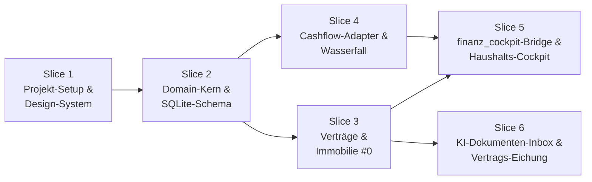

# v1 Roadmap: Fundament, Ordnung & Überblick (Horizont 1)

Dieses Dokument beschreibt den abgestimmten Fahrplan für **v1** von **Coruscant** (Ordnung & Überblick über Haushalt, Verträge, `Immobilie #0`, Wasserfall & Dokumente). Alle Features sind als abgeschlossene **Vertical Slices (Slice 1–6)** geschnitten und folgen strikt `AGENTS.md`, `docs/SPEC.md` und `docs/DESIGN-SYSTEM.md`.

---

## 1. Festgelegte Architektur-Entscheidungen (v1)

| Bereich | Entscheidung | Leitplanke |
| :--- | :--- | :--- |
| **Stack & UI** | Next.js (App Router), TS `strict`, SQLite + Drizzle, Tailwind v4 + `shadcn/ui`, `zod`, Vitest | `src/lib/domain/` bleibt komplett frei von Framework-/DB-Imports; strikte Cent- & Basispunkt-Arithmetik. |
| **Verträge & Immobilien** | Generisches `FinancialContract` + `Property` (`Immobilie #0`) | Keine hartcodierten Spezialfälle; unterjährige Projektion + PDF-Eichung. |
| **Cashflow & Töpfe** | Adapter Modus A + priorisierte Wasserfall-Engine | 1-Klick-Vorschlag für Monatsüberschuss und Einmalzuflüsse. |
| **Integration `finanz_cockpit`** | Geschützter Read-Only-Endpoint `GET /api/external/summary` | Bearer-Token via `.env.local`, nur aggregierte Summen. |
| **Dokumente & KI** | Lokale PDF-Ablage (`data/documents/`) + `zod`-validierter KI-Adapter | SHA256-Duplikatschutz, 1-Klick-Freigabe im Split-Screen-Review, Steuer-Tags. |

---

## 2. Übersicht der Vertical Slices (v1)



| Slice | Titel | Kern-Nutzen |
| :--- | :--- | :--- |
| **Slice 1** | Projekt-Setup, Tooling & Design-System | Lauffähige Next.js-Basis mit Drizzle/SQLite, `shadcn/ui`, Light/Dark-Tokens, 4-Routen-Layout & Vitest. |
| **Slice 2** | DB-Schema & reine Domänen-Logik | Getestete Kern-Logik für Vertrags-Fortschreibung, Cashflow-Normalisierung, Wasserfall-Verteilung & Bilanz. |
| **Slice 3** | `/vertraege`: Verträge & `Immobilie #0` | Kredite, Privatdarlehen, Bausparer und Eigenheim frei anlegen, bearbeiten, pausieren & projizieren. |
| **Slice 4** | `/allokation`: Cashflow (Modus A) & Wasserfall | Haushalts-Positionen pflegen, freien Überschuss sehen & Einmal-/Monatsgelder per 1-Klick auf Töpfe verteilen. |
| **Slice 5** | `finanz_cockpit`-Bridge & `/` Haushalts-Cockpit | Aggregierte Live-Anbindung an `finanz_cockpit`, Hero-Bilanz, Frei-vs.-Gebunden-Balken & Meilenstein-Zeitachse. |
| **Slice 6** | `/dokumente`: KI-Dokumenten-Inbox & Steuer-Tagging | PDF-Upload, KI-Extraktion (`zod`), Split-Screen-Review inkl. Steuer-Tag & Vertrags-Eichung. |

---

## 3. Slice-Details & `/plan-slice`-Prompts

> **Hinweis zur Nutzung:** Kopiere jeweils den Prompt-Block unter dem gewünschten Slice und starte damit `/plan-slice` mit **Agent Argon**. Arbeite die Slices idealerweise von **1 → 6** ab.

---

### Slice 1: Projekt-Setup, Tooling & Design-System-Grundlage

* **Ziel & Scope:**
  * Initialisierung von Next.js (App Router), TypeScript (`strict: true`), Tailwind CSS v4, `shadcn/ui`, `zod`, Drizzle ORM (`better-sqlite3` im WAL-Modus), Vitest und ESLint (`pnpm typecheck`, `pnpm lint`, `pnpm test`).
  * Umsetzung der Farb- und Typografie-Tokens aus `docs/DESIGN-SYSTEM.md` (Light- & Dark-Mode, `tabular-nums`, Status-Badges *Geeicht*, *Modelliert*, *KI-Vorschlag*).
  * Schlankes 4-Routen-Grundgerüst (`/`, `/vertraege`, `/allokation`, `/dokumente`) mit Navigation + `GET /api/health` + `.env.example`.
* **Akzeptanzkriterien:**
  * `pnpm dev` startet fehlerfrei; alle 4 Routen rendern im einheitlichen Layout (Light & Dark).
  * `pnpm typecheck`, `pnpm lint`, `pnpm test` laufen mit 0 Fehlern.

#### Prompt für `/plan-slice` (Slice 1)

```text
/plan-slice Wir starten mit Coruscant v1 – Slice 1: Projekt-Setup, Tooling, Design-System & 4-Routen-Grundgerüst.

Kontext & Vorgaben:
- Lies zuerst `AGENTS.md`, `docs/SPEC.md`, `docs/DESIGN-SYSTEM.md`, `docs/ARCHITECTURE.md` und `docs/V1-ROADMAP.md`.
- Nutze ausschließlich `pnpm`.
- Stack: Next.js (App Router), React, TypeScript (`strict: true`), Tailwind CSS v4, `shadcn/ui`, Lucide Icons, `zod`, Drizzle ORM + `better-sqlite3`, Vitest.

Anforderungen an Slice 1:
1. Projekt- & Tooling-Setup:
   - `package.json` mit Scripts `dev`, `build`, `start`, `typecheck`, `lint`, `test`, `db:generate`, `db:migrate`.
   - `tsconfig.json` (`strict: true`), `vitest.config.ts`, `eslint.config.mjs`, `.env.example`.
2. Datenbank-Basis (`src/db/`):
   - SQLite-Verbindung (`data/coruscant.db`, WAL-Modus, `foreign_keys = ON`) + idempotente Startup-Migration + `GET /api/health`.
3. Design-System & 4-Routen-Shell:
   - Tokens aus `docs/DESIGN-SYSTEM.md` (Light Mode & Dark Mode „Command Deck“), `Inter` + `tabular-nums`, wiederverwendbare Status-Badges (*Geeicht*, *Modelliert*, *KI-Vorschlag*).
   - Navigation für `/`, `/vertraege`, `/allokation`, `/dokumente` (Desktop Header + Mobile-tauglich) mit Platzhalter-Seiten.

Starte gemäß `.agent/workflows/plan-slice.md` erst mit Analyse & Tech-Lead-Interview und speichere den Plan unter `tasks/plan-slice-1.md`.
```

---

### Slice 2: DB-Schema & reine Domänen-Logik

* **Ziel & Scope:**
  * Vollständiges Drizzle-Schema für v1 in `src/db/schema.ts` (`properties`, `financial_contracts`, `cashflow_items`, `pots`, `pot_allocations`, `documents`, `external_snapshots`).
  * Reine Domänen-Module in `src/lib/domain/` (0 Framework-/DB-Imports!):
    1. `contracts.ts`: Unterjährige Fortschreibung von Restschuld/Guthaben aus `currentBalanceCents`, `monthlyRateCents` und `interestRateBps` + Meilenstein-Extraktion.
    2. `cashflow.ts`: Normalisierung von `monthly`/`quarterly`/`yearly` auf Monats-Cent und Berechnung des freien Haushalts-Überschusses.
    3. `waterfall.ts`: Priorisierte Verteilungs-Engine (`fill_to_target` vor `percentage_of_remainder`) für Monatsüberschüsse und Einmalbeträge ohne Überzahlung.
    4. `balance.ts`: Berechnung von Aktiva, Passiva, Nettovermögen und *Frei vs. Gebunden vs. Schulden*.
* **Akzeptanzkriterien:**
  * Umfangreiche Vitest-Suites inkl. Grenz- und Negativfällen (0-Cent, Zins `0 bps`, Überzahlungsschutz, Rundungsreste bei Prozentverteilung).

#### Prompt für `/plan-slice` (Slice 2)

```text
/plan-slice Wir planen Coruscant v1 – Slice 2: Vollständiges SQLite/Drizzle-Schema & reine Domänen-Logik mit Unit-Tests.

Kontext & Vorgaben:
- Lies zuerst `AGENTS.md`, `docs/SPEC.md` und `docs/V1-ROADMAP.md`.
- Strikte Integer-Cent-Arithmetik (`amountCents`) und Basispunkte (`interestRateBps`). Keine `float`-Währungsberechnungen.
- `src/lib/domain/` darf KEINE Next.js-, React-, HTTP- oder DB-Imports enthalten.

Anforderungen an Slice 2:
1. Drizzle-Schema (`src/db/schema.ts`) + initiale Migration für alle 7 Tabellen aus `docs/SPEC.md` §3.
2. Reine Domänen-Logik in `src/lib/domain/`:
   - `contracts.ts`: Projektion von Sparverträgen und Krediten (`annuity`, `installment`, `lump_sum`) ab `balanceAsOfDate`.
   - `cashflow.ts`: Monats-Normalisierung und Überschuss-Berechnung für Modus A.
   - `waterfall.ts`: Vorschlags-Berechnung für `Pot[]` nach Priorität (`fill_to_target`, `fixed_monthly`, `percentage_of_remainder`) inkl. sauberer Restcent-Verteilung.
   - `balance.ts`: Konsolidierte Haushalts-Bilanz (inkl. optionalem `external_snapshot`).
3. Unit-, Grenz- und Negativtests (`*.test.ts`) für alle 4 Domänen-Module.

Starte gemäß Workflow mit Analyse & Tech-Lead-Interview und speichere den Plan unter `tasks/plan-slice-2.md`.
```

---

### Slice 3: `/vertraege` – Verträge & `Immobilie #0`

* **Ziel & Scope:**
  * Server Actions / API-Routes (mit `zod`-Validierung) und UI für `/vertraege`.
  * Generisches Anlegen, Bearbeiten, Pausieren und Löschen von Verträgen (`loan`, `savings_contract`) und Immobilien (`Immobilie #0`).
  * Detail-Drawer pro Vertrag/Immobilie mit projiziertem Stand vs. letztem Eich-Datum sowie verknüpften Dokumenten (Platzhalter bis Slice 6).
* **Akzeptanzkriterien:**
  * Beliebige Kredite (z. B. Hauskredit, zinsloses Privatdarlehen `lump_sum`, Studienkredit) und Bausparer lassen sich ohne Code-Änderung pflegen.

#### Prompt für `/plan-slice` (Slice 3)

```text
/plan-slice Wir planen Coruscant v1 – Slice 3: UI & APIs für `/vertraege` (Verträge, Kredite & Immobilie #0).

Kontext & Vorgaben:
- Lies `AGENTS.md`, `docs/SPEC.md`, `docs/DESIGN-SYSTEM.md`, `src/db/schema.ts` und `src/lib/domain/contracts.ts`.
- Progressive Disclosure: Übersichtliche Karten/Tabellen auf `/vertraege`; Anlegen/Bearbeiten per Modal; Details im Drawer.

Anforderungen an Slice 3:
1. `zod`-Schemas & CRUD-Endpunkte/Actions für `properties` und `financial_contracts`.
2. `/vertraege` UI:
   - Sektion Immobilien (`Immobilie #0` mit geschätztem Wert, verknüpften Krediten/Bausparern).
   - Sektion Verträge & Verbindlichkeiten mit klaren Status-Badges (*Geeicht* vs. *Projiziert*), Zins (`bps`), Rate und Meilenstein.
   - Modal zum Anlegen/Bearbeiten aller Typen (`annuity`, `installment`, `lump_sum`, `savings_contract`) ohne hartcodierte Sonderfälle.

Starte gemäß Workflow mit Analyse & Tech-Lead-Interview und speichere den Plan unter `tasks/plan-slice-3.md`.
```

---

### Slice 4: `/allokation` – Cashflow (Modus A) & Wasserfall

* **Ziel & Scope:**
  * UI & APIs für Haushalts-Positionen (`cashflow_items`) inkl. automatischer Übernahme aktiver Vertragsraten (`contract_linked`) und visueller Kennzeichnung *Modelliert* (`border-dashed`).
  * Verwaltung priorisierter Töpfe (`pots`) mit Fortschrittsbalken.
  * **„Geld verteilen“**-Modal: Betrag eingeben (z. B. Monatsüberschuss oder 5.000 € Einmalzufluss) → Wasserfall-Vorschlag prüfen/anpassen → mit 1 Klick als `pot_allocations` verbuchen.
* **Akzeptanzkriterien:**
  * Monatsüberschuss aktualisiert sich sofort bei Änderung von Haushalts-Positionen oder Vertragsraten; Wasserfall-Buchungen aktualisieren die Topf-Stände atomar.

#### Prompt für `/plan-slice` (Slice 4)

```text
/plan-slice Wir planen Coruscant v1 – Slice 4: `/allokation` (Cashflow-Adapter Modus A, Ziel-Töpfe & Wasserfall-Flow).

Kontext & Vorgaben:
- Lies `AGENTS.md`, `docs/SPEC.md`, `docs/DESIGN-SYSTEM.md`, `src/lib/domain/cashflow.ts` und `src/lib/domain/waterfall.ts`.
- Modellierte Haushalts-Positionen müssen gemäß Design-System klar als „Modelliert“ (`border-dashed`) erkennbar sein.

Anforderungen an Slice 4:
1. CRUD für `cashflow_items` (inkl. Sync/Anzeige verknüpfter `financial_contracts`).
2. CRUD & Prioritäts-Sortierung für `pots` (`fill_to_target`, `fixed_monthly`, `percentage_of_remainder`).
3. „Geld verteilen“-Modal:
   - Input Betrag + Quelle (Monatsüberschuss / Einmalzufluss).
   - Zeigt berechneten Wasserfall-Vorschlag, erlaubt manuelle Korrektur und verbucht atomar in SQLite-Transaktion.

Starte gemäß Workflow mit Analyse & Tech-Lead-Interview und speichere den Plan unter `tasks/plan-slice-4.md`.
```

---

### Slice 5: `finanz_cockpit`-Bridge & `/` Haushalts-Cockpit

* **Ziel & Scope:**
  * Kleiner, geschützter Read-Only-Endpoint `GET /api/external/summary` in `finanz_cockpit` (Bearer-Token) + Sync-Client in `Coruscant` (`external_snapshots`).
  * Ausbau von `/` (**Haushalts-Cockpit**): Hero-KPIs (Aktiva, Passiva, Nettovermögen), 3-Segment-Balken (*Frei/Liquide* vs. *Gebunden* vs. *Schulden*), Status-Anzeige letzter `finanz_cockpit`-Sync und **Meilenstein-Zeitachse**.
* **Akzeptanzkriterien:**
  * Cockpit bleibt ruhig und kompakt; `finanz_cockpit`-Sync funktioniert mit Fallback/Hinweis, falls das Pi-System offline ist.

#### Prompt für `/plan-slice` (Slice 5)

```text
/plan-slice Wir planen Coruscant v1 – Slice 5: `finanz_cockpit`-Bridge & `/` Haushalts-Cockpit.

Kontext & Vorgaben:
- Lies `AGENTS.md`, `docs/SPEC.md`, `docs/ARCHITECTURE.md`, `docs/DESIGN-SYSTEM.md` und `src/lib/domain/balance.ts`.
- Hinweis: Der Read-Only-Endpoint `GET /api/external/summary` muss auch im Nachbar-Repo `/projects/finanz_cockpit` sauber spezifiziert/umgesetzt werden (ohne dortige Datenmodelle zu verändern).

Anforderungen an Slice 5:
1. Bridge-Client in Coruscant (`FINANZ_COCKPIT_URL`, `EXTERNAL_SUMMARY_TOKEN` + `zod`-Validierung) mit Speicherung in `external_snapshots` und Offline-Fallback auf den letzten Snapshot.
2. `/` Haushalts-Cockpit UI:
   - Hero-KPIs (Aktiva, Passiva, Nettovermögen) mit `tabular-nums` und Sync-Button.
   - Balken *Frei vs. Gebunden vs. Schulden*.
   - Nächste Meilensteine aus allen aktiven Verträgen + Top-3-Topf-Fortschritte.

Starte gemäß Workflow mit Analyse & Tech-Lead-Interview und speichere den Plan unter `tasks/plan-slice-5.md`.
```

---

### Slice 6: `/dokumente` – KI-Dokumenten-Inbox & Vertrags-Eichung

* **Ziel & Scope:**
  * Sicherer PDF-Upload unter `data/documents/<jahr>/<uuid>.pdf` mit SHA256-Duplikatprüfung.
  * Abstrakter KI-Adapter (Standard: Gemini via `GEMINI_MODEL`, `zod`-validierte Extraktion von Dokumenttyp, Datum, Aussteller, Betrag, Steuer-Tags `§ 35a`/Lohnanteil und optionalem Vertrags-Eichwert).
  * Split-Screen-Review auf `/dokumente`: Links PDF-Viewer, rechts vorausgefülltes Formular + Checkbox *„Vertragsstand auf X € eichen“* + Archiv-Liste mit Steuer-Filter.
* **Akzeptanzkriterien:**
  * KI mutiert niemals ohne 1-Klick-Freigabe; doppelte PDFs werden abgewiesen; geeichte Verträge aktualisieren `currentBalanceCents` und `balanceAsOfDate`.

#### Prompt für `/plan-slice` (Slice 6)

```text
/plan-slice Wir planen Coruscant v1 – Slice 6: `/dokumente` (KI-Dokumenten-Inbox, Steuer-Tagging & Vertrags-Eichung).

Kontext & Vorgaben:
- Lies `AGENTS.md`, `docs/SPEC.md`, `docs/DESIGN-SYSTEM.md` und `src/db/schema.ts`.
- Gemini-Modell niemals hartcodieren (`process.env.GEMINI_MODEL || DEFAULT_GEMINI_MODEL`), gekapselt hinter einem abstrakten KI-Adapter.
- KI darf niemals Bestandsdaten ohne Nutzer-Bestätigung mutieren.

Anforderungen an Slice 6:
1. PDF-Storage-Service (`data/documents/<jahr>/<uuid>.pdf`, SHA256-Hash-Check, Path-Traversal-Schutz).
2. KI-Extraktions-Service mit `zod`-Schema (Typ, Datum, Aussteller, Betrag, Steuer-Kategorie, Lohnanteil, optional `detectedBalanceCents`).
3. `/dokumente` UI:
   - Upload-Dropzone + Queue *„Zu prüfen“* (Split-Screen: PDF-Preview links, Review-Formular inkl. Eich-Checkbox rechts).
   - Verifiziertes Belegarchiv mit Filter nach Steuerjahr, Objekt/Vertrag und `Steuerrelevant`.

Starte gemäß Workflow mit Analyse & Tech-Lead-Interview und speichere den Plan unter `tasks/plan-slice-6.md`.
```

---

### Slice 6b: Vertrag/Kredit direkt aus PDF anlegen (KI-Formular-Vorausfüllung)

* **Ziel & Scope:**
  * Erweiterung des KI-Extraktors (`src/lib/integrations/gemini-document-extractor.ts` & `src/lib/validation/documents.ts`) um ein optionales `extractedContract`-Schema (`name`, `provider`, `category`, `currentBalanceCents`, `balanceAsOfDate`, `monthlyRateCents`, `interestRateBps`, `repaymentType`, `specialRepaymentMaxYearlyCents`, `fixedInterestUntil`, `targetSumCents`, `allocationThresholdPercent`, `futureLoanInterestRateBps`, `milestoneDate`, `milestoneLabel`), inkl. gezieltem Prompt-Hinweis auf Konditionenübersicht / ESIS-Merkblatt bei mehrseitigen Kreditverträgen.
  * Atomarer API-Flow (SQLite-Transaktion), um einen neuen `FinancialContract` anzulegen, optional einer Immobilie (`linkedPropertyId`) zuzuordnen und das hochgeladene PDF direkt als `verified` am Vertrag zu verknüpfen (`linkedContractId`, 1:N-Historie bleibt erhalten).
  * **Einstieg A (`/vertraege`):** Im „Neuer Vertrag“-Modal (`contract-modal.tsx`) ein Bereich *„Aus PDF vorbefüllen (KI)“*, der das PDF hochlädt, analysiert und alle erkannten Formularfelder direkt ausfüllt (unbekannte Felder bleiben leer).
  * **Einstieg B (`/dokumente`):** Im Review-Panel (`document-review-panel.tsx`) Modus-Umschalter *„Bestehendem Vertrag zuordnen“* vs. *„Als neuen Vertrag anlegen“* (mit Property-Auswahl und vorausgefüllten Vertragsfeldern).
* **Akzeptanzkriterien:**
  * Ein hochgeladener Hauskredit- oder Bausparvertrag füllt das Vertragsformular automatisch vor; nach 1-Klick-Bestätigung existieren Vertrag, Immobilien-Zuordnung und verknüpftes PDF konsistent in der DB.
  * Teil-Erkennungen (z. B. Zins erkannt, Rate `null`) stürzen nicht ab, sondern lassen fehlende Felder sauber editierbar.
  * `pnpm typecheck`, `pnpm lint`, `pnpm test` laufen mit 0 Fehlern durch.

#### Prompt für `/plan-slice` (Slice 6b)

```text
/plan-slice Wir planen Coruscant v1 – Slice 6b: Vertrag/Kredit direkt aus PDF anlegen (KI-Vorausfüllung in /vertraege & /dokumente).

Kontext & Vorgaben:
- Lies zuerst `AGENTS.md`, `docs/SPEC.md`, `docs/DESIGN-SYSTEM.md`, `docs/V1-ROADMAP.md`, `src/lib/validation/documents.ts`, `src/lib/validation/contracts.ts`, `src/lib/integrations/gemini-document-extractor.ts`, `src/components/vertraege/contract-modal.tsx`, `src/components/dokumente/document-review-panel.tsx` und `src/app/api/documents/route.ts`.
- Strikte Integer-Cent- (`amountCents`) und Basispunkt-Arithmetik (`interestRateBps`, z. B. 3,45 % -> 345).
- KI darf niemals stillschweigend einen Vertrag anlegen: immer erst vorausgefüllte Formular-Vorschau, dann explizite Nutzer-Bestätigung.
- Ein Vertrag kann 1:N mehrere PDFs besitzen (`documents.linkedContractId`).

Anforderungen an Slice 6b:
1. Schema & KI-Extraktion:
   - Erweitere `aiDocumentExtractionSchema` in `src/lib/validation/documents.ts` um ein optionales `extractedContract`-Objekt (alle Vertragskonditionen für `loan` und `savings_contract`, nullable bei Nicht-Erkennung).
   - Erweitere `EXTRACTION_PROMPT` in `gemini-document-extractor.ts` (inkl. Hinweis auf Konditionenübersicht / ESIS-Merkblatt bei mehrseitigen Verträgen und exakter Umrechnung von Zinssätzen in Basispunkte).
2. Atomarer Backend-Flow:
   - Endpunkt / Transaktion zum gleichzeitigen Erstellen eines `FinancialContract` (inkl. `linkedPropertyId`) und Verifizieren/Verknüpfen des hochgeladenen `Document` (`linkedContractId`, `status = 'verified'`).
   - Saubere Behandlung, falls das PDF bereits existiert (SHA256-Duplikatschutz).
3. Zwei UI-Einstiege ohne doppelte Logik:
   - Einstieg A (`/vertraege` in `contract-modal.tsx`): Bei Neuanlage optionaler Bereich „Aus PDF vorbefüllen (KI)“ → Upload + Analyse → Formularfelder werden vorausgefüllt (mit Hinweis, welche Felder manuell zu prüfen sind) → Speichern legt Vertrag + Verknüpfung atomar an.
   - Einstieg B (`/dokumente` in `document-review-panel.tsx`): Modus-Umschalter „Bestehendem Vertrag zuordnen“ vs. „Als neuen Vertrag anlegen“ (inkl. Zuordnung zu `Immobilie #0` und editierbaren Vertragsfeldern).
4. Tests:
   - Unit-Tests für `extractedContract`-Validierung (Happy-Path, Teil-Erkennung mit `null`-Feldern, ungültige Bps/Cent-Werte) und Integrationstest für die atomare Vertrag+Dokument-Erstellung.

Starte gemäß `.agent/workflows/plan-slice.md` erst mit Analyse & Tech-Lead-Interview und speichere den Plan unter `tasks/plan-slice-6b.md`.
```

---

### Slice 6c: Immobilien-Stammdaten, Objektbild & Vertrags-Verknüpfung im Drawer

* **Ziel & Scope:**
  * Erweiterung von `properties` in `src/db/schema.ts` um optionale Stammdaten: `street`, `houseNumber`, `postalCode`, `city`, `livingAreaSqm`, `usableAreaSqm`, `plotAreaSqm`, `constructionYear`, `energyClass` sowie `imagePath` (lokales Titelbild).
  * Sicherer Bild-Upload (`POST /api/properties/[id]/image` & `GET /api/properties/[id]/image` & `DELETE`) unter `data/property-images/` (JPEG/PNG/WebP, Größenlimit, Path-Traversal-Schutz) inkl. Anzeige auf der Immobilien-Karte und im `property-detail-drawer.tsx`.
  * UX-Polish im `property-detail-drawer.tsx`: Direkte Möglichkeit, **bestehende Verträge** aus einer Liste unverknüpfter Verträge mit 1 Klick der Immobilie zuzuordnen (oder Verknüpfung zu lösen).
* **Akzeptanzkriterien:**
  * Alle neuen Immobilien-Felder sind optional; bestehende Immobilien funktionieren ohne Pflichtangaben weiter.
  * Bild-Upload prüft MIME-Type, Dateigröße und schützt vor Path Traversal; `data/property-images/` ist in `.gitignore` abgedeckt.
  * Im Immobilien-Drawer lassen sich bestehende Verträge direkt verknüpfen und lösen.
  * `pnpm typecheck`, `pnpm lint`, `pnpm test` laufen mit 0 Fehlern durch.

#### Prompt für `/plan-slice` (Slice 6c)

```text
/plan-slice Wir planen Coruscant v1 – Slice 6c: Erweiterte Immobilien-Stammdaten, Objekt-Anzeigebild & direkte Vertrags-Verknüpfung im Immobilien-Drawer.

Kontext & Vorgaben:
- Lies zuerst `AGENTS.md`, `docs/SPEC.md`, `docs/DESIGN-SYSTEM.md`, `docs/V1-ROADMAP.md`, `src/db/schema.ts`, `src/lib/validation/contracts.ts`, `src/lib/storage/pdf-storage.ts`, `src/components/vertraege/property-modal.tsx`, `src/components/vertraege/property-detail-drawer.tsx` und `src/components/vertraege/vertraege-workspace.tsx`.
- Datenschutz: `street` und `houseNumber` bleiben rein lokal; `data/property-images/` darf nicht in Git landen (`.gitignore` prüfen/ergänzen).
- Design-System: Objektbild dezent und ruhig in die Karte und den Drawer integrieren (kein überladenes Immobilienportal-Layout).

Anforderungen an Slice 6c:
1. Schema & Migration (`properties`):
   - Optionale Felder ergänzen: `street`, `houseNumber`, `postalCode`, `city`, `livingAreaSqm`, `usableAreaSqm`, `plotAreaSqm`, `constructionYear`, `energyClass`, `imagePath`.
   - `zod`-Validierung für Create/Update anpassen (sinnvolle Grenzen z. B. Baujahr, Flächen als positive Ganzzahlen).
2. Objekt-Anzeigebild:
   - Storage-Helper + API `POST`/`GET`/`DELETE /api/properties/[id]/image` (erlaubte Typen: JPEG, PNG, WebP; Max-Größe z. B. 5 MB; Magic-Bytes/MIME-Prüfung, Path-Traversal-Schutz).
   - Bild-Upload/-Entfernen im `property-modal.tsx` oder `property-detail-drawer.tsx` sowie sauberes Thumbnail auf der Immobilien-Karte.
3. UX-Polish im `property-detail-drawer.tsx`:
   - Sektion „Verknüpfte Verträge“ um ein kompaktes Control „Bestehenden Vertrag verknüpfen“ erweitern (listet unverknüpfte Verträge auf und setzt `linkedPropertyId` per PATCH auf `/api/contracts/[id]`), plus Möglichkeit zum Lösen einer Verknüpfung.
4. Tests:
   - Validierungs-Tests für die neuen Immobilien-Felder (inkl. Grenz-/Negativfälle), API-Tests für Bild-Upload/Auslieferung/Löschung (inkl. ungültiger MIME-Type / 404) und Verknüpfungs-Update.

Starte gemäß `.agent/workflows/plan-slice.md` erst mit Analyse & Tech-Lead-Interview und speichere den Plan unter `tasks/plan-slice-6c.md`.
```

---

### Slice 6d: Automatischer `finanz_cockpit`-Sync & direkte Verlinkung

* **Ziel & Scope:**
  * Automatischer, regelmäßiger Abgleich mit `finanz_cockpit` (z. B. Auto-Refresh beim Laden von `/` falls letzter Snapshot älter als konfiguriertes Intervall ist, sowie optionaler periodischer Hintergrund-Sync im Server-Prozess).
  * Direkte, dezente Verlinkung auf das persönliche `finanz_cockpit` (z. B. *„Mein Cockpit ↗“* im Header/AppShell oder bei der persönlichen Sphäre auf `/`, konfigurierbar über `NEXT_PUBLIC_FINANZ_COCKPIT_URL` bzw. Server-Config).
* **Akzeptanzkriterien:**
  * Beim Öffnen von Coruscant aktualisiert sich der `finanz_cockpit`-Snapshot automatisch, sobald der letzte Sync veraltet ist (ohne UI zu blockieren, mit sauberem Offline-Fallback).
  * Ein Klick auf den Cockpit-Link öffnet das persönliche `finanz_cockpit` im neuen Tab.
  * `pnpm typecheck`, `pnpm lint`, `pnpm test` laufen mit 0 Fehlern durch.

#### Prompt für `/plan-slice` (Slice 6d)

```text
/plan-slice Wir planen Coruscant v1 – Slice 6d: Regelmäßiger Auto-Sync mit finanz_cockpit & direkte Verlinkung.

Kontext & Vorgaben:
- Lies zuerst `AGENTS.md`, `docs/SPEC.md`, `docs/DESIGN-SYSTEM.md`, `src/lib/integrations/finanz-cockpit-client.ts`, `src/app/api/external/sync/route.ts`, `src/components/app-shell.tsx` und `src/components/cockpit/`.
- UI bleibt ruhig: Der Link auf `finanz_cockpit` soll dezent im Header/Cockpit sitzen und nur erscheinen, wenn eine Ziel-URL konfiguriert ist.

Anforderungen an Slice 6d:
1. Auto-Sync-Strategie:
   - Konfigurierbares Sync-Intervall (z. B. Stale-Check beim Aufruf von `/` oder Hintergrund-Taktgeber mit sauberem Timeout/Offline-Fallback auf den letzten Snapshot).
2. Verlinkung auf `finanz_cockpit`:
   - Konfigurierbare URL (`.env.example` ergänzen) + dezenter externer Link (*„finanz_cockpit ↗“*) in `app-shell.tsx` / auf `/`.
3. Tests:
   - Unit-/Integrationstests für den Stale-/Auto-Sync-Check (frischer Snapshot wird nicht unnötig neu geladen, veralteter Snapshot triggert Sync, Offline-Fehler fällt sauber zurück).

Starte gemäß `.agent/workflows/plan-slice.md` erst mit Analyse & Tech-Lead-Interview und speichere den Plan unter `tasks/plan-slice-6d.md`.
```
