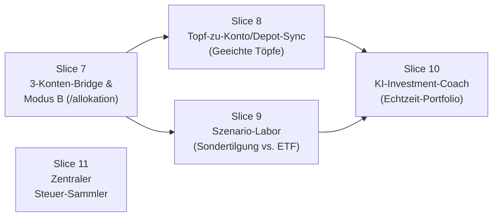

# v2 Roadmap: 3-Konten-Bridge, Strategie, Investieren & Steuer (Horizont 2)

Dieses Dokument beschreibt den abgestimmten Fahrplan für **v2** von **Coruscant** (anschließend an **v1 / Slice 6d**). Da Coruscant erst mit dem 3-Konten-Modell produktiv geht, wird die **Gemeinschaftskonto-Bridge** direkt in v2 vorgezogen und auf `dev` mit Dummy-Werten gegen echte `finanz_cockpit`-Daten getestet. Alle Slices folgen strikt `AGENTS.md`, `docs/SPEC.md` und `docs/DESIGN-SYSTEM.md`.

---

## 1. Festgelegte Architektur-Entscheidungen (v2)

| Bereich | Entscheidung | Leitplanke |
| :--- | :--- | :--- |
| **3-Konten-Bridge (`finanz_cockpit`)** | `finanz_cockpit` übernimmt Bank-Sync, Fixkosten & Budgets fürs Gemeinschaftskonto (`ADR-008`, `ADR-009`) | Abwärtskompatible Erweiterung von `GET /api/external/summary` um `household`, `accounts[]` & `positions[]`; Dev-Dummy-Modus in Coruscant für den `household`-Block. |
| **Variable Kosten (`/allokation`)** | Live-Toggle zwischen **Plan-Budget** und **rollendem 3-/6-Monats-Ist-Durchschnitt** | Im laufenden Betrieb jederzeit umschaltbar; echte Fixkosten/Gehälter tragen Badge *Geeicht*, manuelle Zusatzposten *Modelliert*. |
| **Topf-Sync** | Optionale 1:1-Kopplung von `Pot` an ein Konto/Depot aus `finanz_cockpit` | Gekoppelte Töpfe spiegeln den echten Ist-Stand (*Geeicht*), statt manuell nachgebucht zu werden. |
| **Szenario-Labor** | Reine Domänen-Simulation (`src/lib/domain/`) ohne DB-Mutation | Strikte Cent-/Bps-Arithmetik für *Sondertilgung vs. ETF* (inkl. Kapitalertragsteuer/Teilfreistellung) und *Gehaltssprung*. |
| **Investment-Coach & Steuer** | KI-Coach auf echten Depot-Positionen + zentraler Steuer-Sammler | Coach erklärt & prüft Risiken/Ziele (keine Kauf-Signale für Einzelaktien); Steuer-Sammler bündelt alle Belege je Steuerjahr. |

---

## 2. Übersicht der Vertical Slices (v2)



| Slice | Titel | Kern-Nutzen |
| :--- | :--- | :--- |
| **Slice 7** | 3-Konten-Bridge & Cashflow-Adapter Modus B | Gemeinschaftskonto-Daten (Fixkosten, Gehälter, Budget vs. Ø-Ist-Toggle) aus `finanz_cockpit` + Dev-Dummy-Modus. |
| **Slice 8** | Topf-zu-Konto/Depot-Sync | Virtuelle Töpfe (Notgroschen, ETF-Tilgungsersatz) mit echten Konten/Depots koppeln und automatisch eichen. |
| **Slice 9** | Szenario-Labor („Was-wäre-wenn?“) | Fundierter Vergleich *Sondertilgung vs. ETF-Ansparung* und *Gehaltssprung-Simulation* mit Schiebereglern. Vorabpauschale bewusst nicht modelliert (konservativ für ETF). |
| **Slice 10** ✅ | KI-Investment-Coach (Einsteiger-Assistent) | Portfolio- & Risiko-Analyse auf Basis echter Depot-Positionen aus `finanz_cockpit` + eigener Lebensziele. |
| **Slice 11** | Zentraler Steuer-Sammler | Jahresübersicht aller steuerrelevanten Belege/Posten pro §-Kategorie inkl. Export-Mappe. |

---

## 3. Slice-Details & `/plan-slice`-Prompts

> **Hinweis zur Nutzung:** Kopiere jeweils den Prompt-Block unter dem gewünschten Slice und starte damit `/plan-slice` mit **Agent Argon**.

---

### Slice 7: 3-Konten-Bridge & Cashflow-Adapter Modus B (Gemeinschaftskonto)

* **Ziel & Scope:**
  * **In `finanz_cockpit`:** Konten um optionales `scope` (`personal` | `household`, Default `personal`) erweitern; `GET /api/external/summary` abwärtskompatibel um `household` ergänzen (Kontostand, erkannte Fixkosten/Gehälter aus `recurring_contracts`, variable Ausgaben sowohl als `plannedBudgetsCents` als auch `rollingAvg3MCents` und `rollingAvg6MCents`).
  * **In `Coruscant`:** Erweiterung von `external_snapshots` & Bridge-Client um `household` + sauberer **Dev-Dummy-/Fixture-Modus**, sodass Coruscant auf `dev` ohne echtes Gemeinschaftskonto vollständig testbar ist.
  * **In `/allokation`:** Adapter-Ansicht für Modus B mit **Live-Toggle** (*Plan-Budget* vs. *Ø 3 Monate* vs. *Ø 6 Monate*) für variable Alltagskosten (Lebensmittel, Hunde, Freizeit) plus Beibehaltung manueller Zusatzposten (*Modelliert*).
* **Akzeptanzkriterien:**
  * Umschalten zwischen *Plan-Budget* und *Ø 3M / 6M* aktualisiert den freien Monatsüberschuss sofort und deterministisch.
  * Bestehende `finanz_cockpit`-Summen für `personal` bleiben abwärtskompatibel.
  * `pnpm typecheck`, `pnpm lint`, `pnpm test` laufen in beiden Repos mit 0 Fehlern durch.

#### Prompt für `/plan-slice` (Slice 7)

```text
/plan-slice Wir planen Coruscant v2 – Slice 7: 3-Konten-Bridge & Cashflow-Adapter Modus B (Gemeinschaftskonto via finanz_cockpit).

Kontext & Vorgaben:
- Lies zuerst `AGENTS.md`, `docs/SPEC.md`, `docs/ARCHITECTURE.md`, `docs/DESIGN-SYSTEM.md`, `docs/V2-ROADMAP.md`, `src/lib/integrations/finanz-cockpit-client.ts`, `src/lib/domain/cashflow.ts` und `src/components/allokation/allokation-workspace.tsx`.
- Prüfe auch `/projects/finanz_cockpit/src/app/api/external/summary/` sowie `/projects/finanz_cockpit/src/db/schema.ts`.
- Strikte Integer-Cent-Arithmetik (`amountCents`), reine Domänen-Logik in `src/lib/domain/`, `zod`-Validierung auf beiden Seiten der Bridge.

Anforderungen an Slice 7:
1. Erweiterung `finanz_cockpit` (abwärtskompatibel):
   - Konten-Scope (`personal` | `household`, Default `personal`).
   - `GET /api/external/summary` liefert zusätzlich optional `household`: `{ balanceCents, recurringInflowCents, recurringOutflowCents, variableBudgetsCents, variableRollingAvg3MCents, variableRollingAvg6MCents, categoriesBreakdown }`.
2. Coruscant Bridge & Dev-Dummy-Modus:
   - `zod`-Schema und `external_snapshots` um `household`-Daten erweitern.
   - Konfigurierbarer Dev-Dummy-Adapter für `household` (falls in `finanz_cockpit` noch kein `household`-Konto existiert), damit Modus B auf `dev` realistisch getestet werden kann.
3. `/allokation` UI (Modus B + Live-Toggle):
   - Anzeige der geeichten Fixkosten & Gehälter (`Geeicht`) vs. manueller Planposten (`Modelliert`).
   - Live-Toggle für variable Alltagskosten: **Plan-Budget** ↔ **Ø 3 Monate** ↔ **Ø 6 Monate**, der direkt den freien Monatsüberschuss für den Wasserfall neu berechnet.
4. Tests:
   - Domänen-Tests für Modus-B-Cashflow-Berechnung (alle 3 Toggle-Modi, Kombination mit manuellen Planposten, Negativ-Überschuss-Grenzfall) sowie Bridge-Schema-Tests.

Starte gemäß `.agent/workflows/plan-slice.md` erst mit Analyse & Tech-Lead-Interview und speichere den Plan unter `tasks/plan-slice-7.md`.
```

---

### Slice 8: Topf-zu-Konto/Depot-Sync (`finanz_cockpit`-Bridge v2)

* **Ziel & Scope:**
  * Erweiterung von `GET /api/external/summary` um aggregierte Einzelkonten (`accounts[]`) und Depot-Bestände (`positions[]` inkl. aktuellem Wert & Kurs-Timestamp).
  * In `Coruscant` (`/allokation` & `pots`): Optionale Verknüpfung eines Topfs (z. B. *Notgroschen* → Tagesgeldkonto, *ETF-Tilgungsersatz* → Trade Republic / ETF) mit einem externen Konto/Asset aus `finanz_cockpit`.
  * Gekoppelte Töpfe übernehmen ihren Ist-Stand automatisch beim Bridge-Sync und tragen das Badge *Geeicht*.
* **Akzeptanzkriterien:**
  * Virtuelle (manuelle) und konto-gekoppelte (geeichte) Töpfe funktionieren sauber nebeneinander im Wasserfall.
  * Bei Offline-Zustand von `finanz_cockpit` bleibt der letzte geeichte Topf-Stand erhalten.

#### Prompt für `/plan-slice` (Slice 8)

```text
/plan-slice Wir planen Coruscant v2 – Slice 8: Topf-zu-Konto/Depot-Sync über die finanz_cockpit-Bridge.

Kontext & Vorgaben:
- Lies `AGENTS.md`, `docs/SPEC.md`, `docs/DESIGN-SYSTEM.md`, `docs/V2-ROADMAP.md`, `src/db/schema.ts`, `src/lib/domain/waterfall.ts` und `src/components/allokation/pot-modal.tsx`.
- Gekoppelte Töpfe dürfen beim Auto-Sync ihren Ist-Stand aktualisieren, während ungekoppelte Töpfe weiterhin rein virtuell über `pot_allocations` laufen.

Anforderungen an Slice 8:
1. Bridge-Erweiterung (`finanz_cockpit` + Coruscant):
   - `GET /api/external/summary` liefert zusätzlich `accounts[]` (id, name, type, balanceCents) und `positions[]` (symbol, isin, name, assetClass, marketValueCents, costBasisCents, lastPriceAt).
2. Schema & Pot-Kopplung:
   - `pots` um `externalAccountId` (oder `externalPositionKey`) erweitern.
   - Sync-Logik aktualisiert `currentCents` gekoppelter Töpfe und markiert sie in der UI als `Geeicht`.
3. UI (`pot-modal.tsx` & `allokation-workspace.tsx`):
   - Dropdown im Topf-Modal zur optionalen Kopplung an ein externes Konto/Depot aus dem letzten Snapshot.
4. Tests:
   - Unit-/Integrationstests für gemischten Wasserfall (geeichte + virtuelle Töpfe) und Sync-Aktualisierung ohne Überschreiben ungekoppelter Töpfe.

Starte gemäß `.agent/workflows/plan-slice.md` erst mit Analyse & Tech-Lead-Interview und speichere den Plan unter `tasks/plan-slice-8.md`.
```

---

### Slice 9: Szenario-Labor („Was-wäre-wenn?“)

* **Ziel & Scope:**
  * Reine Simulations-Engine in `src/lib/domain/scenarios.ts` (0 DB-Mutationen, strikte Cent-/Bps-Arithmetik):
    1. **Sondertilgung vs. ETF-Ansparung:** Vergleicht sichere Zinsersparnis durch Sondertilgung (auf Basis eines realen Kredits aus `/vertraege`) gegen ETF-Ansparung mit konfigurierbarer Rendite (`bps`), Sparerpauschbetrag / Teilfreistellung / Abgeltungsteuer bis zum Zinsbindungsende (Restschuld-Ablösung auf einen Schlag).
    2. **Gehaltssprung-Simulation:** Simuliert veränderte monatliche Überschüsse (z. B. Vollzeit ab April) auf die Zeit bis zum Erreichen definierter Topf-Ziele (Notgroschen, Mutter-Darlehen, Wohnungs-EK).
  * Ruhige UI-Integration (z. B. als eigener Bereich/Tab oder Route `/planung` mit klaren Schiebereglern & 1 Vergleichs-Chart).
* **Akzeptanzkriterien:**
  * Vorbelegung mit echten Daten (Hauskredit, Zinsbindung, aktuelle Topf-Ziele), ohne jemals echte DB-Werte zu verändern.
  * Saubere Grenzfalltests für Steuern, 0 %-Zins und unterschiedliche Laufzeiten.

#### Prompt für `/plan-slice` (Slice 9)

```text
/plan-slice Wir planen Coruscant v2 – Slice 9: Szenario-Labor (Sondertilgung vs. ETF-Ansparung & Gehaltssprung-Simulation).

Kontext & Vorgaben:
- Lies `AGENTS.md`, `docs/SPEC.md`, `docs/DESIGN-SYSTEM.md`, `docs/V2-ROADMAP.md` und `src/lib/domain/contracts.ts`.
- Reine Finanzmathematik in Integer-Cent und Basispunkten (`src/lib/domain/scenarios.ts`) – keine Floats.
- Ruhige UI ohne Trading-Terminal-Überladung.

Anforderungen an Slice 9:
1. Domänen-Engine (`src/lib/domain/scenarios.ts`):
   - `simulatePrepaymentVsEtf`: Monatliche Simulation bis Zinsbindungsende (Restschuld mit Sondertilgung vs. ETF-Endwert nach konfigurierbarer Rendite, Teilfreistellung 30 %, Sparerpauschbetrag & Abgeltungsteuer → Netto-Vorteil).
   - `simulateCashflowChange`: Zeitachse bis zum Füllen priorisierter Töpfe bei verändertem Monatsüberschuss.
2. UI & Vorbelegung:
   - Auswahl eines bestehenden `loan`-Vertrags als Startparameter; interaktive Schieberegler; klare Ergebniskarte (*Modelliert*).
3. Tests:
   - Umfangreiche Unit-Tests (0 %-Rendite, 0 %-Zins, Sondertilgungs-Deckel, Steuerfreibetrag-Grenzen).

Starte gemäß `.agent/workflows/plan-slice.md` erst mit Analyse & Tech-Lead-Interview und speichere den Plan unter `tasks/plan-slice-9.md`.
```

---

### Slice 10: KI-Investment-Coach (Einsteiger-Assistent) – umgesetzt

* **Umgesetzte Entscheidungen (Plan: `tasks/plan-slice-10.md`):**
  1. **Anonymer Kontext per Allowlist:** Nur ETF-Name und ISIN (öffentliche Fondsdaten) gehen an die KI; Einzelaktien/Krypto nur als Referenz + Gewicht; Konten, Töpfe und Verträge nur als Refs/Enums. Der Server baut den Kontext bei jedem Request neu, der Client liefert nur Sparrate und Chat-Nachrichten.
  2. **`pots.purpose`** (`emergency_fund | goal | investment | NULL`) steuert Notgroschen-Abdeckung und Ziel-Horizonte.
  3. **Rebalancing:** Die KI liefert nur Ziel-Gewichte (Bps, Summe 10.000), die Domäne rechnet Soll-Werte, Deltas und Monate über Zukäufe (*Modelliert*).
  4. **Stateless-UI:** Drawer auf `/planung`, kein Persistieren; Gemini-Transport in `gemini-transport.ts` geteilt mit der Dokumenten-Extraktion.

* **Ziel & Scope:**
  * Verständlicher Strategie- & Lern-Assistent auf Basis der echten Depot-Positionen (aus Slice 8) und der eigenen Ziele/Zeithorizonte aus Coruscant (Haus-Ablösung, Mutter-Darlehen, langfristiger Aufbau).
  * Liefert **strukturierte Einordnungen** (Allokation nach Asset-Klassen, Klumpenrisiko, Zeithorizont-Passung, Rebalancing-Hinweise, verständliche Erklärung von Begriffen) – **keine** spekulativen Kaufempfehlungen für Einzelaktien.
* **Akzeptanzkriterien:**
  * Coach arbeitet ausschließlich mit anonymisierten Depot-Positionen & Zielen (ohne Namen/IBANs).
  * Alle Antworten sind ruhig, nachvollziehbar und an bestehende Regeln (`GEMINI_MODEL`) gekoppelt.

#### Prompt für `/plan-slice` (Slice 10)

```text
/plan-slice Wir planen Coruscant v2 – Slice 10: KI-Investment-Coach für Einsteiger auf Basis echter Depotdaten & Lebensziele.

Kontext & Vorgaben:
- Lies `AGENTS.md`, `docs/SPEC.md`, `docs/DESIGN-SYSTEM.md`, `docs/V2-ROADMAP.md` und den bestehenden KI-Adapter (`src/lib/integrations/`).
- Datenschutz: Keine persönlichen Namen, IBANs oder Adressen im KI-Kontext.
- Fachliche Leitplanke: Der Coach gibt Risiko-, Allokations- und Verständnis-Einordnungen passend zu Zeithorizonten – keine spekulativen Einzelaktien-Tipps.

Anforderungen an Slice 10:
1. Kontext-Builder (`src/lib/domain/investment-context.ts`):
   - Verdichtet Depot-Positionen (Asset-Klasse, Gewicht %), Liquidität/Notgroschen, anstehende Meilensteine (Darlehen/Zinsbindung) und Sparrate zu einem anonymisierten Portfolio-Kontext.
2. KI-Coach-Service & `zod`-Schema:
   - Strukturierte Portfolio-Bewertung (Stärken, Risiken/Klumpen, Zeithorizont-Check, Rebalancing-Vorschlag) + interaktiver Q&A-Chat für Einsteigerfragen.
3. Ruhige UI-Integration (z. B. Drawer/Panel im Cockpit oder unter `/allokation`).
4. Tests:
   - Unit-Tests für den anonymisierten Kontext-Builder (keine PII-Leaks) und Schema-Validierung der Coach-Antworten.

Starte gemäß `.agent/workflows/plan-slice.md` erst mit Analyse & Tech-Lead-Interview und speichere den Plan unter `tasks/plan-slice-10.md`.
```

---

### Slice 11: Zentraler Steuer-Sammler

* **Ziel & Scope:**
  * Jahresübersicht aller steuerrelevanten Posten aus `documents` (und optional Verträgen/Kreditzinsen) pro Steuerjahr (`taxYear`).
  * Gruppierung und Summenbildung nach `taxCategory` (`handwerker_35a` mit separatem Lohnanteil & 20 %-Erstattungs-Orientierung, `haushaltsnahe_dl_35a`, `werbungskosten_vv`, `capital_gains`, `other`).
  * Saubere Export-Funktion (Druckansicht `@media print` im hellen Layout + ZIP/CSV-Belegmappe für Steuererklärung oder Steuerberater).
* **Akzeptanzkriterien:**
  * Reine Domänen-Aggregation der Steuerposten mit Grenzfalltests (z. B. § 35a-Höchstbeträge).
  * 1-Klick-Export eines kompletten Steuerjahres inkl. verknüpfter PDFs.

#### Prompt für `/plan-slice` (Slice 11)

```text
/plan-slice Wir planen Coruscant v2 – Slice 11: Zentraler Steuer-Sammler & Jahres-Belegmappe.

Kontext & Vorgaben:
- Lies `AGENTS.md`, `docs/SPEC.md`, `docs/DESIGN-SYSTEM.md`, `docs/V2-ROADMAP.md`, `src/db/schema.ts` und `src/lib/domain/documents.ts`.
- `@media print` rendert strikt im hellen Layout mit `tabular-nums`.

Anforderungen an Slice 11:
1. Domänen-Aggregation (`src/lib/domain/tax-summary.ts`):
   - Summiert verifizierte Dokumente eines Steuerjahres je `taxCategory` (inkl. `deductibleAmountCents` und unverbindlichem Hinweis zu gesetzlichen Höchstbeträgen wie § 35a).
2. Export-Endpoint:
   - Strukturierte Übersicht + ZIP-Download (Übersichts-CSV/JSON + zugehörige PDF-Belege eines Steuerjahres).
3. UI-Integration (Steuer-Tab/Ansicht unter `/dokumente` oder eigene kompakte Steuer-Übersicht):
   - Jahres-Auswahl, Kategorie-Karten mit Summen, Belegliste und Print-/ZIP-Export.
4. Tests:
   - Unit-Tests für die Jahres-Aggregation (nur `verified` Dokumente, unvollständige Beträge, Grenzfälle) und API-Export-Tests.

Starte gemäß `.agent/workflows/plan-slice.md` erst mit Analyse & Tech-Lead-Interview und speichere den Plan unter `tasks/plan-slice-11.md`.
```

---

### Slice 7b: Vereinfachung `/allokation` auf das 3-Konten-Zielbild (Modus-A-Toggle entfernen)

* **Ziel & Scope:**
  * Da Coruscant erst mit aktivem 3-Konten-Modell in Produktivbetrieb geht (`ADR-009`), wird der doppelte Modus-A/B-Umschalter auf `/allokation` entfernt.
  * `/allokation` zeigt direkt **ein einheitliches, finales Modell**:
    1. **Live-Basis aus `finanz_cockpit`** (Gemeinschaftskonto-Gehälter, Fixkosten & variable Alltagskosten mit Live-Toggle *Plan-Budget* ↔ *Ø 3M* ↔ *Ø 6M*),
    2. **plus optionale manuelle Plan-Posten** (`cashflow_items`) für zukünftige/geplante Änderungen (*Modelliert*).
  * Der Dev-Dummy-Fallback bleibt sauber in der Bridge-/Integrationsschicht gekapselt, falls lokal noch keine echten `household`-Daten ankommen.
* **Akzeptanzkriterien:**
  * Keine verwirrende Modus-A/Modus-B-Umschaltung mehr in der UI; `/allokation` fühlt sich exakt so an wie im späteren Live-Betrieb.
  * `pnpm typecheck`, `pnpm lint`, `pnpm test` laufen mit 0 Fehlern durch.

#### Prompt für `/plan-slice` (Slice 7b)

```text
/plan-slice Wir planen Coruscant v2 – Slice 7b: Vereinfachung `/allokation` auf das einheitliche 3-Konten-Zielbild (Entfernung Modus-A/B-Umschalter).

Kontext & Vorgaben:
- Lies zuerst `AGENTS.md`, `docs/SPEC.md`, `docs/DESIGN-SYSTEM.md`, `docs/V2-ROADMAP.md`, `src/lib/domain/cashflow.ts`, `src/db/queries/allocation.ts` und `src/components/allokation/allokation-workspace.tsx`.
- Ziel: Die App soll sich auf `dev` bereits exakt so verhalten und anfühlen wie später live im 3-Konten-Modell.

Anforderungen an Slice 7b:
1. UI-Bereinigung (`allokation-workspace.tsx`):
   - Entferne den Modus-A/Modus-B-Schalter aus `/allokation`.
   - Zeige oben klar die **Gemeinschaftskonto-Basis** (`finanz_cockpit`-Sync: Gehälter, Fixkosten, variabler Kosten-Toggle *Plan-Budget* ↔ *Ø 3M* ↔ *Ø 6M*) mit Status *Geeicht* (bzw. dezentem Hinweis, falls Dev-Dummy-Daten aktiv sind).
   - Zeige darunter als aufgeräumte Sektion die **Optionalen Plan-Posten (`Modelliert`)** für manuelle Zusatz-Annahmen (z. B. zukünftige Ausgaben/Einnahmen, plus verknüpfte Coruscant-Vertragsraten ohne Doppelzählung).
2. Domäne & API:
   - Bereinige `cashflow.ts` / `allocation.ts`, sodass immer die konsolidierte Berechnung (Bridge-Haushaltsdaten + optionale manuelle Plan-Posten) aktiv ist.
3. Tests:
   - Bestehende Cashflow- & API-Tests sauber auf das einheitliche Modell aktualisieren und mit 0 Fehlern bestehen.

Starte gemäß `.agent/workflows/plan-slice.md` erst mit Analyse & Tech-Lead-Interview und speichere den Plan unter `tasks/plan-slice-7b.md`.
```
